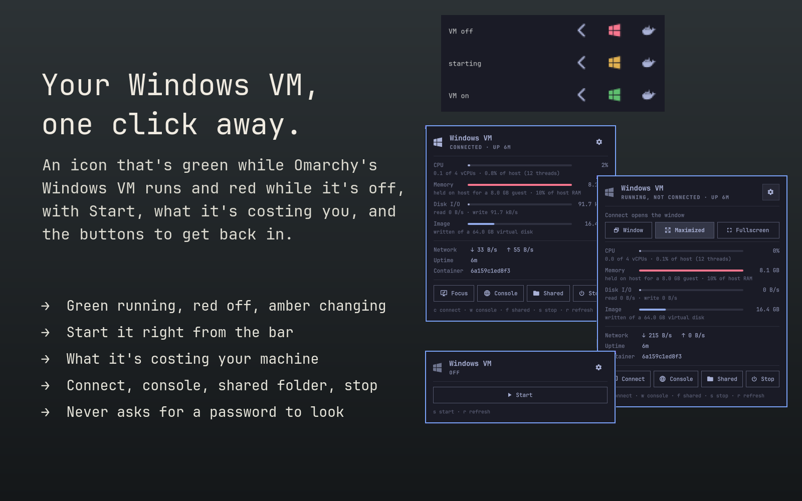
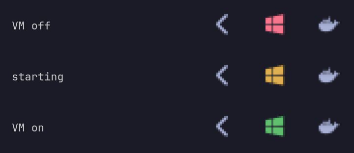
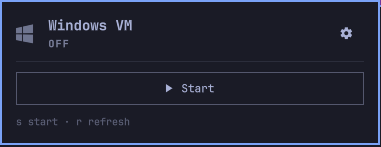
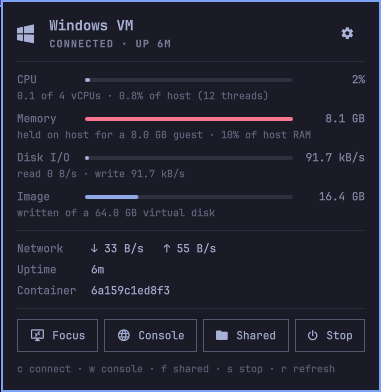
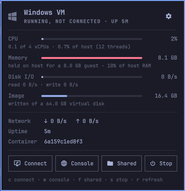
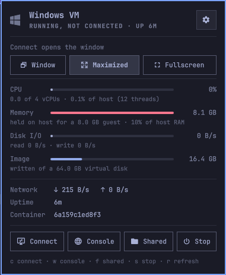

# Windows VM — an Omarchy bar widget

Your Windows VM, one click away. It's an icon in the bar that's red while
Omarchy's Windows VM (`omarchy-windows-vm`) is off, with a Start button in its
panel, and green while it runs.

This is a fork of [jonspinks/omarchy-winvm](https://github.com/jonspinks/omarchy-winvm)
that adds Start, the red/green icon, prompt-free Start and Stop when you have
Docker access, and a choice of how the Connect window opens. It keeps the
upstream plugin id, `blacksheep.winvm`, so install it in place of the original.



## What you get

Omarchy can run Windows in a VM, but once it's going, it's easy to lose
track of: is it still running? How much is it eating? How do I get back to
it? This answers all three from the bar.

**Always there, and its colour says what the VM is doing.** The icon stays in
the bar whether or not Windows is running, as long as the VM is installed
(it's hidden on a machine without it). Its colour is the status:

| Colour | State |
|---|---|
| green | the VM is running |
| red | the VM is off |
| amber | starting up or shutting down |

When it's off, click the icon (or right-click it) to open the panel and press
**Start**. `bin/winvm-start` clears the setgid bit on `~/Windows` (see
Troubleshooting) and starts the container.





**What it's costing you.** Click it for the VM's CPU, memory, disk and network,
measured two ways: against what you gave the guest, and against your whole
machine. You can see whether it's the VM making your laptop hot, or something
else.



**Straight back in.** **Connect** opens the Windows desktop, or brings it to
the front if it's already open. **Console** opens the VM's web console, and
**Shared** opens the folder you share with it. **Stop** shuts Windows down
cleanly. The keyboard works too: `c`, `w`, `f`, `s`.





**Never nags.** Watching the VM never asks for a password, because every number
comes from files you can already read. Start and Stop don't ask either if your user
can already use Docker (the `docker` group); otherwise they go through
Omarchy's own prompt, as they always did.

## Install

```bash
omarchy plugin remove blacksheep.winvm --yes   # only if the original is installed
omarchy plugin add https://github.com/bmaltais/omarchy-winvm --enable
```

`--enable` places it in the bar; `omarchy plugin enable blacksheep.winvm --before omarchy.agents`
puts it somewhere specific. It stays hidden only on a machine where the VM isn't installed.

## Remove

```bash
omarchy plugin remove blacksheep.winvm
```

This takes it out of the bar and deletes the plugin folder. It changes nothing
else: the VM, its data in `~/.windows` and `~/Windows`, and its credentials
are Omarchy's and stay as they are. The only files the plugin ever creates are
`~/.config/windows/winvm-window-mode` (your window choice, below) and
`~/.config/windows/krb5.conf`, and only if the Omarchy launcher hasn't
already created it (see Connect below). It's safe to leave in place.

## Settings

The cog in the panel's header chooses how **Connect** opens the Windows
window, and it takes effect on the next Connect:

- **Window**: a normal tiled window.
- **Maximized** (the default): fills the screen but keeps the bar and gaps.
- **Fullscreen**: covers everything, bar included.

Maximized and fullscreen are Hyprland's own states, applied by
`bin/winvm-connect` once the window appears. The choice is one word in
`~/.config/windows/winvm-window-mode`; `bin/winvm-mode get` and
`bin/winvm-mode set <mode>` read and write it.

## Interactions

| Gesture | What happens |
|---|---|
| hover | state, CPU, memory, disk and network rates (just the state while off) |
| left click | panel |
| right click | focus the RDP window, or open one; start the VM when it's off |
| `c` | Connect / Focus |
| `w` | web console at `http://127.0.0.1:8006` (useful while Windows is still booting and RDP isn't up) |
| `f` | open `~/Windows`, the folder the guest sees as a network share |
| `s` | start the VM when it's off; shut it down when it's running (press twice) |
| `r` | resample now |

**Connect** doesn't go through `omarchy-windows-vm launch`, because on a VM
that's already running that re-runs the privileged bring-up and asks for a
password just to reconnect. `bin/winvm-connect` starts `xfreerdp3` itself,
using the credentials the installer saved in `~/.config/windows/credentials`
and the same flags as the launcher. Closing a window opened this way leaves
the VM running.

If that file is missing, Connect refuses and says so. It doesn't fall back to
the image's well-known `docker`/`admin` defaults. The password goes to FreeRDP
through a file descriptor (`/args-from:fd`), not the command line, so other
local users can't read it from `/proc/<pid>/cmdline`. `/cert:ignore` skips RDP
certificate checks, which is safe only because the target is always the local
container on `127.0.0.1`.

**Start and Stop** use plain `docker start` / `docker stop` on the
`omarchy-windows` container when your user already has Docker access, so there
is no prompt, and Stop leaves the container in place for the next Start. The
plugin never grants itself that access. Without it, or when the container
hasn't been created yet (first run, or after a reboot dropped the protected
mounts), Start falls back to `omarchy-windows-vm launch --keep-alive`, which
opens an RDP window and asks once.

Without Docker access, **Stop** asks for your password once. If the original `launch` is still
waiting on its RDP window, `bin/winvm-stop` closes that window and lets the
launcher stop the VM, as it would anyway. Stopping the container directly
would make the launcher ask for a password a second time. Docker's SIGTERM
becomes an ACPI shutdown in the guest, so Windows gets to shut down cleanly.
It only closes RDP windows it can still match to the session it found: each
one is identified by pid and start time, checked again just before the kill,
so a pid that was reused by another process is left alone.

## The numbers

`bin/winvm-sample` reads everything without privileges. It doesn't need the
docker group, so the widget never prompts for a password:

| Figure | Source |
|---|---|
| detection | a `docker-*.scope` cgroup holding a `qemu-system-*` process named `windows` |
| CPU | cgroup `cpu.stat`, against the guest's vCPUs (from qemu's `-smp`) and against the host |
| Memory | cgroup `memory.current`, against the guest's `-m` |
| Disk I/O | cgroup `io.stat`, the busiest single device (dm-crypt and the NVMe under it report the same bytes) |
| Network | `eth0` in the qemu process's network namespace |
| Image | allocated blocks of the sparse `~/.windows/data.img` |

Memory is the host's view. Windows zeroes its RAM at boot, so a running guest
holds nearly all of its allocation whatever Task Manager says. The meter shows
what the VM takes from Linux, not how much Windows is using.

A sample takes about 30ms. The widget polls every 5s while closed
(which is also how quickly the icon turns green after the VM starts) and every 2s
while the panel is open. Both are settable inline in `shell.json`:

```json
{ "id": "blacksheep.winvm", "interval": 2, "idleInterval": 5 }
```

## Requirements

- The Omarchy Windows VM, installed with `omarchy-windows-vm install`
- Docker with the systemd cgroup driver on cgroup v2 (the Arch default), so
  the container shows up as a `docker-<id>.scope` under `system.slice`

Everything else it runs ships with Omarchy or the Windows VM install:
`xfreerdp3` (FreeRDP 3, which the VM installer pulls in), `jq`, `hyprctl`,
`xdg-open`, and `omarchy-launch-or-focus`. Stopping the VM goes through
`omarchy-windows-vm stop`, which asks for authorization with polkit. The
plugin itself never uses sudo, pkexec or the Docker socket.

## Troubleshooting

**The icon never appears.** It only shows when the VM is installed, which the
widget decides by looking for `~/.config/windows/credentials`. Check with
`bin/winvm-sample`: it prints `"installed":true` when it finds the VM set up
(`{"running":false,"installed":true}` while it's off), and `"installed":false`
if not.

**The icon is red but the VM is running.** The widget finds the VM by looking
for a `qemu-system-*` process named `windows` inside a `docker-*.scope` cgroup.
If `bin/winvm-sample` says `"running":false` while Windows is up, that
detection is what failed (see Requirements).

**The VM starts once, then won't start again.** This is an Omarchy bug, not
this widget: the container sets the setgid bit on `~/Windows`, and the
launcher's permission check then fails without saying why. Run
`chmod g-s ~/Windows` and launch again. It's tracked at
[omacom/omarchy#13244](https://github.com/omacom/omarchy/issues/13244).

## License

MIT
