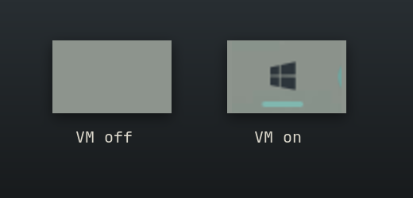

# Windows VM — an Omarchy bar widget

Your Windows VM, one click away. It's an icon that turns up in the bar only
while Omarchy's Windows VM (`omarchy-windows-vm`) is running.


## What you get

Omarchy can run Windows in a VM, but once it's going, it's easy to lose
track of: is it still running? How much is it eating? How do I get back to
it? This answers all three from the bar.

**It's only there when it matters.** No VM, no icon. Start Windows and the
icon appears. Shut it down and it's gone again.



**What it's costing you.** Click it for the VM's CPU, memory, disk and network,
measured two ways: against what you gave the guest, and against your whole
machine. You can see whether it's the VM making your laptop hot, or something
else.


**Straight back in.** **Connect** opens the Windows desktop, or brings it to
the front if it's already open. **Console** opens the VM's web console, and
**Shared** opens the folder you share with it. **Stop** shuts Windows down
cleanly. The keyboard works too: `c`, `w`, `f`, `s`.


**Never nags.** Watching the VM never asks for a password, because every number
comes from files you can already read. Only Stop asks, through Omarchy's own
prompt, as it always does.

## Install

```bash
omarchy plugin add https://github.com/jonspinks/omarchy-winvm --enable
```

`--enable` places it in the bar; `omarchy plugin enable blacksheep.winvm --before omarchy.agents`
puts it somewhere specific. It stays hidden until the VM is running.

## Remove

```bash
omarchy plugin remove blacksheep.winvm
```

This takes it out of the bar and deletes the plugin folder. It changes nothing
else: the VM, its data in `~/.windows` and `~/Windows`, and its credentials
are Omarchy's and stay as they are. The only file the plugin ever creates is
`~/.config/windows/krb5.conf`, and only if the Omarchy launcher hasn't
already created it (see Connect below). It's safe to leave in place.

## Interactions

| Gesture | What happens |
|---|---|
| hover | state, CPU, memory, disk and network rates |
| left click | panel |
| right click | focus the RDP window, or open one |
| `c` | Connect / Focus |
| `w` | web console at `http://127.0.0.1:8006` (useful while Windows is still booting and RDP isn't up) |
| `f` | open `~/Windows`, the folder the guest sees as a network share |
| `s`, twice | shut the VM down |
| `r` | resample now |

**Connect** doesn't go through `omarchy-windows-vm launch`, because on a VM
that's already running that re-runs the privileged bring-up and asks for a
password just to reconnect. `bin/winvm-connect` starts `xfreerdp3` itself,
using the credentials the installer saved in `~/.config/windows/credentials`
and the same flags as the launcher. Closing a window opened this way leaves
the VM running.

If that file is missing, Connect refuses and says so. It doesn't fall back to
the image's well-known `docker`/`admin` defaults. The password goes to FreeRDP
through a file descriptor (`/args-from:fd`), not the command line, so other
local users can't read it from `/proc/<pid>/cmdline`. `/cert:ignore` skips RDP
certificate checks, which is safe only because the target is always the local
container on `127.0.0.1`.

**Stop** asks for your password once. If the original `launch` is still
waiting on its RDP window, `bin/winvm-stop` closes that window and lets the
launcher stop the VM, as it would anyway. Stopping the container directly
would make the launcher ask for a password a second time. Docker's SIGTERM
becomes an ACPI shutdown in the guest, so Windows gets to shut down cleanly.
It only closes RDP windows it can still match to the session it found: each
one is identified by pid and start time, checked again just before the kill,
so a pid that was reused by another process is left alone.

## The numbers

`bin/winvm-sample` reads everything without privileges. It doesn't need the
docker group, so the widget never prompts for a password:

| Figure | Source |
|---|---|
| detection | a `docker-*.scope` cgroup holding a `qemu-system-*` process named `windows` |
| CPU | cgroup `cpu.stat`, against the guest's vCPUs (from qemu's `-smp`) and against the host |
| Memory | cgroup `memory.current`, against the guest's `-m` |
| Disk I/O | cgroup `io.stat`, the busiest single device (dm-crypt and the NVMe under it report the same bytes) |
| Network | `eth0` in the qemu process's network namespace |
| Image | allocated blocks of the sparse `~/.windows/data.img` |

Memory is the host's view. Windows zeroes its RAM at boot, so a running guest
holds nearly all of its allocation whatever Task Manager says. The meter shows
what the VM takes from Linux, not how much Windows is using.

A sample takes about 30ms. The widget polls every 5s while closed
(which is also how quickly the icon appears after the VM starts) and every 2s
while the panel is open. Both are settable inline in `shell.json`:

```json
{ "id": "blacksheep.winvm", "interval": 2, "idleInterval": 5 }
```

## Requirements

- The Omarchy Windows VM, installed with `omarchy-windows-vm install`
- Docker with the systemd cgroup driver on cgroup v2 (the Arch default), so
  the container shows up as a `docker-<id>.scope` under `system.slice`

Everything else it runs ships with Omarchy or the Windows VM install:
`xfreerdp3` (FreeRDP 3, which the VM installer pulls in), `jq`, `hyprctl`,
`xdg-open`, and `omarchy-launch-or-focus`. Stopping the VM goes through
`omarchy-windows-vm stop`, which asks for authorization with polkit. The
plugin itself never uses sudo, pkexec or the Docker socket.

## Troubleshooting

**The icon never appears.** It only shows while the container is running.
Check with `bin/winvm-sample`, which prints `{"running":false}` when it can't
find the VM.

**The VM starts once, then won't start again.** This is an Omarchy bug, not
this widget: the container sets the setgid bit on `~/Windows`, and the
launcher's permission check then fails without saying why. Run
`chmod g-s ~/Windows` and launch again. It's tracked at
[omacom/omarchy#13244](https://github.com/omacom/omarchy/issues/13244).

## License

MIT
